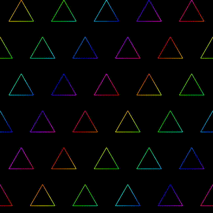
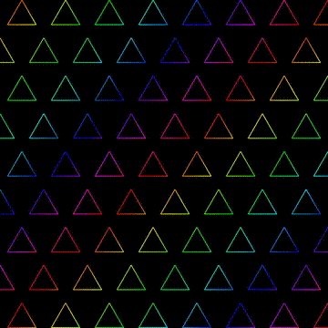
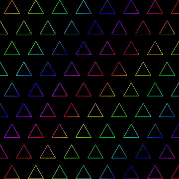
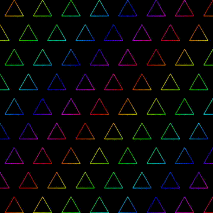
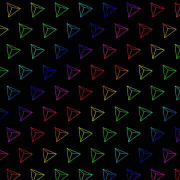
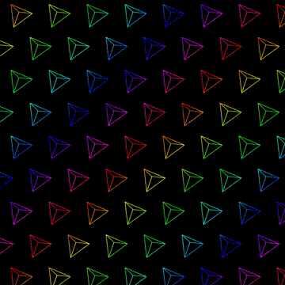
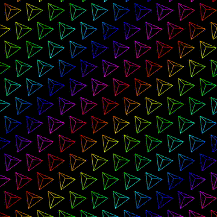
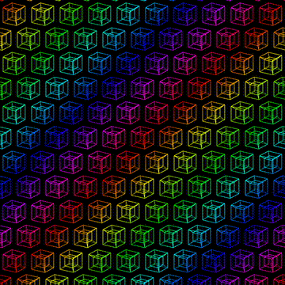
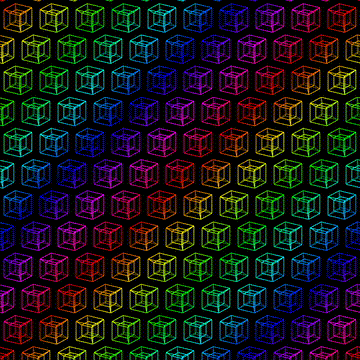
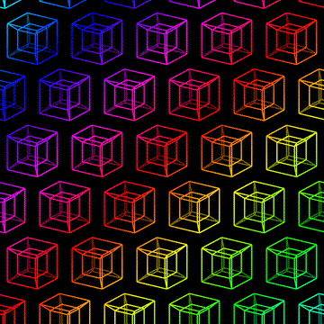

# platonics

> **Media upload status:** Generator source files and metadata are committed here. The 67 original PNGs, 11 MP4s, 8 source ZIPs, and derived GIF previews are prepared in the downloadable archive but still need a local Git push. The preview links below will work once that push is complete. See [PUBLISH_MEDIA.md](PUBLISH_MEDIA.md).

Neon-rainbow line geometry: 2D polygon morphs, 3D Platonic solids, and 4D hypercube projections. Contains every original generated still and available video from the **Platonic Solids** conversation (November 18–19, 2026), with their original code-based renderers and render specifications.

## Render previews

The 2-second GIFs are convenience previews generated from the original MP4s. Open the linked MP4 for full duration, resolution, and frame rate.

| Family | Preview | Original MP4 |
| --- | --- | --- |
| 2D · 1080×1080 · 60/1 fps · 33.00s |  | [polygon-morph-2d.mp4](renders/videos/2d/polygon-morph-2d.mp4) |
| 2D · 1080×1080 · 60/1 fps · 12.00s |  | [triangle-to-hexagon-loop.mp4](renders/videos/2d/triangle-to-hexagon-loop.mp4) |
| 2D · 1080×1080 · 62/1 fps · 1.94s |  | [triangle-to-hexagon-124bpm.mp4](renders/videos/2d/triangle-to-hexagon-124bpm.mp4) |
| 2D · 1080×1080 · 124/1 fps · 0.97s |  | [triangle-to-hexagon-124bpm-2x.mp4](renders/videos/2d/triangle-to-hexagon-124bpm-2x.mp4) |
| 2D · 1080×1080 · 248/1 fps · 0.48s |  | [triangle-to-hexagon-124bpm-4x.mp4](renders/videos/2d/triangle-to-hexagon-124bpm-4x.mp4) |
| 3D · 1080×1080 · 124/1 fps · 1.45s |  | [platonic-solids-124bpm-2x.mp4](renders/videos/3d/platonic-solids-124bpm-2x.mp4) |
| 3D · 1080×1080 · 248/1 fps · 0.73s |  | [platonic-solids-124bpm-4x.mp4](renders/videos/3d/platonic-solids-124bpm-4x.mp4) |
| 3D · 1080×1080 · 124/1 fps · 19.35s |  | [platonic-solids-124bpm-slow.mp4](renders/videos/3d/platonic-solids-124bpm-slow.mp4) |
| 4D · 1080×1080 · 124/1 fps · 11.61s |  | [hypercube-124bpm-slow.mp4](renders/videos/4d/hypercube-124bpm-slow.mp4) |
| 4D · 3840×3840 · 60/1 fps · 11.62s |  | [hypercube-4k-60fps.mp4](renders/videos/4d/hypercube-4k-60fps.mp4) |
| 4D · 3840×3840 · 60/1 fps · 11.62s |  | [hypercube-4k-60fps-2x-zoom.mp4](renders/videos/4d/hypercube-4k-60fps-2x-zoom.mp4) |

## Collection

- **67 original PNGs** are in [`renders/stills/`](renders/stills/). Browse the [still-image gallery](STILLS.md).
- **11 original MP4s** are in `renders/videos/{2d,3d,4d}/`, including the 3840×3840 60fps hypercube versions at normal and 2× zoom.
- **8 original source archives**, unchanged, are preserved in [`source-archives/`](source-archives/). Their source code, JSON specifications, and geometry files are also extracted in [`generators/`](generators/).
- **11 optional animated GIF previews** and **67 thumbnail WebPs** are derived assets. They are not replacements for the originals.
- `MANIFEST.csv` contains SHA-256 checksums for all original assets. Run `python3 tools/verify_media.py` to verify recovered bytes.

## Animation families

| Source directory | Description |
| --- | --- |
| [`generators/2d/polygon-morph/`](generators/2d/polygon-morph/) | 3–12 sided polygons + circle, 33-second loop |
| [`generators/2d/triangle-to-hexagon/`](generators/2d/triangle-to-hexagon/) | Tightened 12-second triangle → hexagon loop |
| [`generators/2d/triangle-to-hexagon-124bpm/`](generators/2d/triangle-to-hexagon-124bpm/) | Four polygon steps, one 124 BPM bar |
| [`generators/2d/triangle-to-hexagon-fast-loops/`](generators/2d/triangle-to-hexagon-fast-loops/) | 2× (124 fps) and 4× (248 fps) variants |
| [`generators/3d/platonic-solids-124bpm/`](generators/3d/platonic-solids-124bpm/) | Five Platonic solids + sphere, fast 2× and 4× |
| [`generators/3d/platonic-solids-124bpm-slow/`](generators/3d/platonic-solids-124bpm-slow/) | Slower 3D loop **without sphere** with tighter spacing |
| [`generators/4d/hypercube-124bpm-slow/`](generators/4d/hypercube-124bpm-slow/) | Three tesseract projections in a continuous morph |
| [`generators/4d/hypercube-4k-60fps/`](generators/4d/hypercube-4k-60fps/) | 4K 60fps hypercube, 1× and 2× zoom |

## Re-rendering

Python 3.10+, NumPy, Pillow, and FFmpeg + FFprobe on your PATH.

```bash
python3 -m pip install -r requirements.txt
cd generators/4d/hypercube-4k-60fps
python3 render_animation.py --preview --render --zoom 1 --threads 4
python3 render_animation.py --preview --render --zoom 2 --threads 4
```

For each other family, see its own `README.md` for the exact command, output filename, timing, BPM, and geometric conventions. The 4K videos are **3840×3840 square** at 60 fps, not the 16:9 3840×2160 UHD convention.

**Still-image provenance:** the original PNGs are AI-generated raster artworks. Their precise image-generation seeds and model pipelines are not present; the Python geometry renderers reproduce the code-generated animated sets, not pixel-identical recreations of all 67 PNG artworks.

## Files and formats

The original 4K MP4 files are large (≈92 MB and ≈54 MB). GitHub warns on files over 50 MiB and rejects files over 100 MiB; both recovered originals are under the hard limit. Git LFS is an option for future large videos.

Regenerate all lightweight previews: `bash tools/make_preview_gifs.sh`.

No audio is embedded in the videos. For VJ looping, start on a downbeat and repeat the clip.
