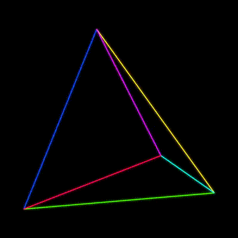
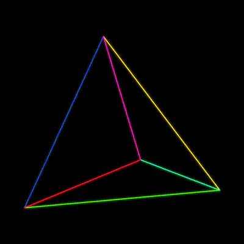
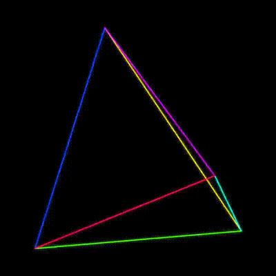
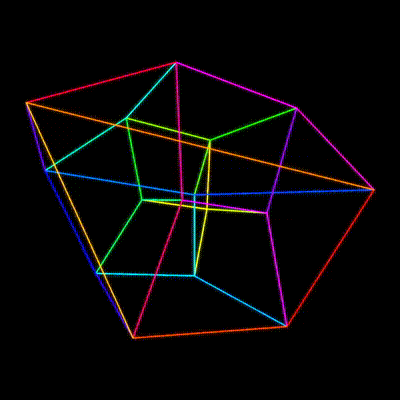
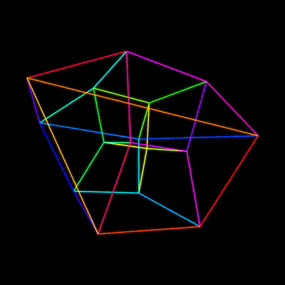

# Single-form animations

These 11 videos retain the **original files’ FPS, frame counts, durations, and output dimensions**. Geometry is regenerated as one large central 2D polygon, 3D solid, or 4D hypercube instead of a tiled array. The 2D morphs move through their respective polygon sequences; the 3D and 4D geometries rotate and transition according to their original timing.

The 3840×3840 60fps hypercube videos are uploaded using verified Git chunks and assembled on GitHub Actions. If Actions is disabled, run `python3 tools/assemble_single_4k.py` in a clone containing `media-parts/single-4k/`.

Reproduce the animations with [`generators/single-forms/render_single_animation.py`](generators/single-forms/render_single_animation.py).

| Animated preview | Output MP4 | Geometry and timing |
|:---:|---|---|
|  | [polygon-morph-2d.mp4](renders/videos-single/2d/polygon-morph-2d.mp4) | 2D, 1080×1080, 60/1 fps, 1980 frames |
|  | [triangle-to-hexagon-124bpm-2x.mp4](renders/videos-single/2d/triangle-to-hexagon-124bpm-2x.mp4) | 2D, 1080×1080, 124/1 fps, 120 frames |
|  | [triangle-to-hexagon-124bpm-4x.mp4](renders/videos-single/2d/triangle-to-hexagon-124bpm-4x.mp4) | 2D, 1080×1080, 248/1 fps, 120 frames |
|  | [triangle-to-hexagon-124bpm.mp4](renders/videos-single/2d/triangle-to-hexagon-124bpm.mp4) | 2D, 1080×1080, 62/1 fps, 120 frames |
|  | [triangle-to-hexagon-loop.mp4](renders/videos-single/2d/triangle-to-hexagon-loop.mp4) | 2D, 1080×1080, 60/1 fps, 720 frames |
|  | [platonic-solids-124bpm-2x.mp4](renders/videos-single/3d/platonic-solids-124bpm-2x.mp4) | 3D, 1080×1080, 124/1 fps, 180 frames |
|  | [platonic-solids-124bpm-4x.mp4](renders/videos-single/3d/platonic-solids-124bpm-4x.mp4) | 3D, 1080×1080, 248/1 fps, 180 frames |
|  | [platonic-solids-124bpm-slow.mp4](renders/videos-single/3d/platonic-solids-124bpm-slow.mp4) | 3D, 1080×1080, 124/1 fps, 2400 frames |
|  | [hypercube-124bpm-slow.mp4](renders/videos-single/4d/hypercube-124bpm-slow.mp4) | 4D, 1080×1080, 124/1 fps, 1440 frames |
|  | [hypercube-4k-60fps-2x-zoom.mp4](renders/videos-single/4d/hypercube-4k-60fps-2x-zoom.mp4) | 4D, 3840×3840, 60/1 fps, 697 frames |
|  | [hypercube-4k-60fps.mp4](renders/videos-single/4d/hypercube-4k-60fps.mp4) | 4D, 3840×3840, 60/1 fps, 697 frames |
